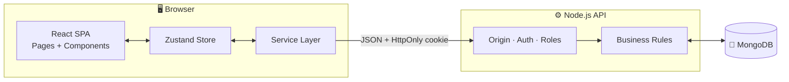
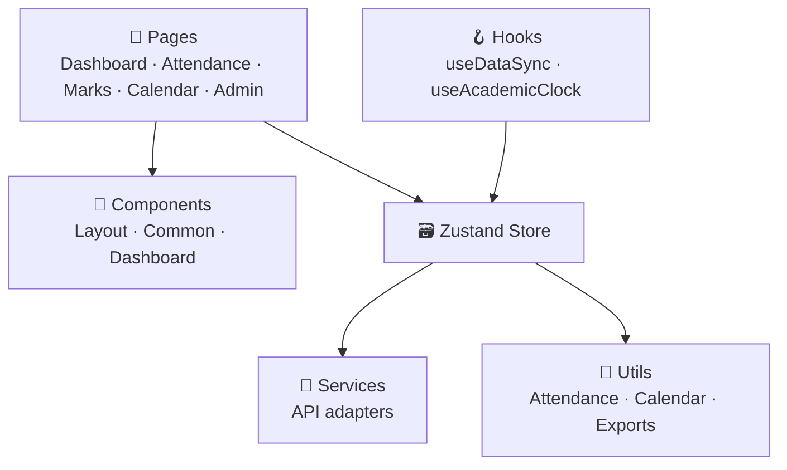
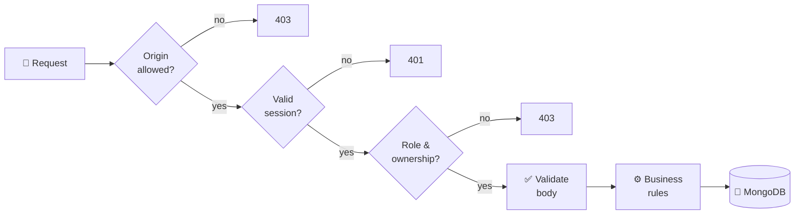
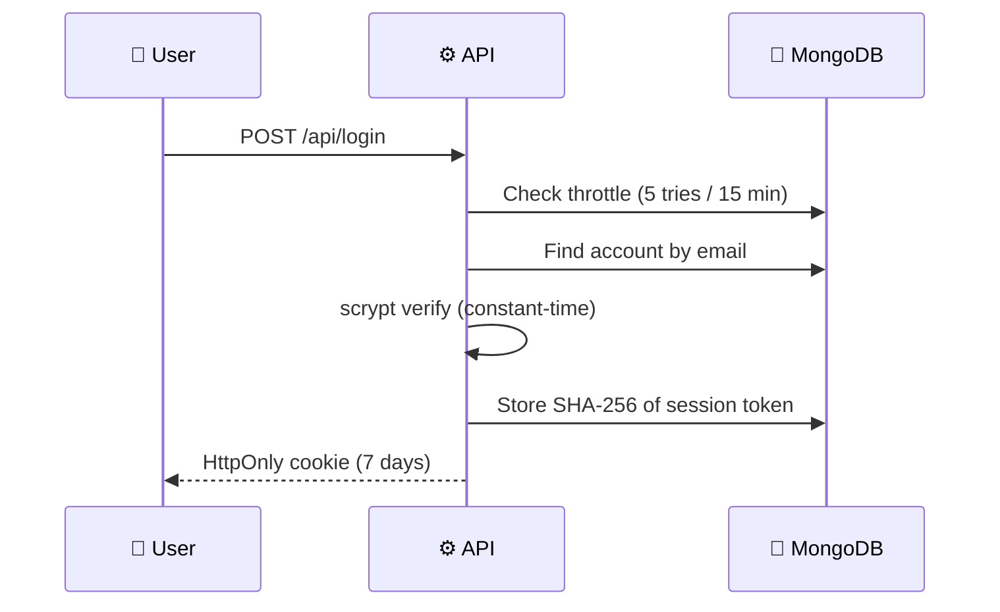
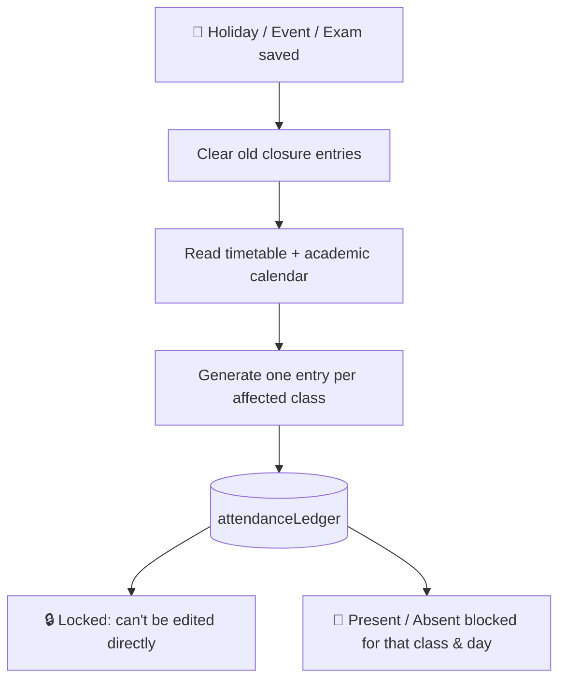

<div align="center">

# 🎓 StudentOS

### Your attendance, schedule, and results — one dashboard.

*Which class is next? Which subject is at risk? How are my results trending?*

<br>


[Features](#-features) · [Architecture](#-architecture) · [Tech Stack](#-tech-stack) · [Quick Start](#-quick-start) · [Structure](#-project-structure)

</div>

---

## ✨ Features

<table>
<tr>
<td width="50%" valign="top">

### 📊 Smart Attendance
Every subject is checked against the **75% rule**. Below it? StudentOS tells you exactly how many classes to attend to recover.

</td>
<td width="50%" valign="top">

### 🗓️ Timetable & Calendar
Weekly timetable, holidays, exams, and events. Closures never count as a missed class.

</td>
</tr>
<tr>
<td width="50%" valign="top">

### 🎓 Marks & Results
Subject marks plus **SGPA / YGPA** across eight semesters, side by side with attendance.

</td>
<td width="50%" valign="top">

### 📈 Analytics
Charts, progress tracking, and a dashboard that surfaces what needs attention first.

</td>
</tr>
<tr>
<td width="50%" valign="top">

### 📄 One-Click Exports
Download attendance as **PDF**, **Excel**, or **CSV**.

</td>
<td width="50%" valign="top">

### 🔎 Global Search
Jump to any subject, class, or record from anywhere in the app.

</td>
</tr>
<tr>
<td width="50%" valign="top">

### 🌗 Day & Night Mode
Applied before first paint, synced across tabs, and honored on every screen.

</td>
<td width="50%" valign="top">

### 🔐 Student & Admin Roles
Server-enforced roles. Admins publish shared data; students keep their own private records.

</td>
</tr>
</table>

### Attendance ledger at a glance

| Entry | Effect |
| :---: | :----- |
| ✅ **Present** | Counts as attended |
| ❌ **Absent** | Counts as held, not attended |
| 💤 **OFF** | Teacher didn't take the class — *not counted* |
| 🎉 **Event / Holiday** | Calendar closure — *not counted* |
| ♻️ **Reset** | Clears the entry |

---

## 🏗️ Architecture

> **The server decides. The dashboard presents.**

### System overview



### Frontend layers



### Backend request pipeline



### Sign-in flow



### Attendance closure engine



### Who can do what

| Action | 🎓 Student | 🛡️ Admin |
| :----- | :--------: | :------: |
| Read shared timetable, calendar, subjects | ✅ | ✅ |
| Read own attendance, marks, results | ✅ | ✅ |
| Read another student's records | ❌ | ✅ |
| Publish shared data to everyone | ❌ | ✅ |
| Customize a personal copy | ✅ | — |
| Manage student accounts | ❌ | ✅ |
| Edit automatic closure entries | ❌ | ❌ |

---

## 🧰 Tech Stack

| | Technology |
| :-- | :-- |
| 🎨 **Interface** | React 18 · TypeScript · Tailwind CSS 4 · Motion |
| 🧭 **State & Routing** | Zustand · React Router |
| 📊 **Charts & Reports** | Recharts · jsPDF · write-excel-file |
| ✅ **Validation** | Zod |
| ⚙️ **Backend** | Node.js 24 |
| 🍃 **Database** | MongoDB |
| 🔥 **Optional** | Firebase Web SDK |
| 🧪 **Quality** | Node test runner · GitHub Actions |

---

## 🚀 Quick Start

```bash
# 1. Clone
git clone <repository-url>
cd StudentOS

# 2. Install
npm ci

# 3. Configure
cp .env.example .env      
```

Fill in `.env`:

| Variable | What to enter |
| :-- | :-- |
| `MONGODB_URI` | Private MongoDB connection string |
| `MONGODB_DB` | A **new, empty** database name |
| `INITIAL_STUDENT_EMAIL` / `INITIAL_STUDENT_PASSWORD` | Student login |
| `INITIAL_ADMIN_EMAIL` / `INITIAL_ADMIN_PASSWORD` | Admin login |
| `APP_ORIGIN` | `http://localhost:5500` for development |

```bash
# 4. Start the API
npm run dev:api

# 5. Start the dashboard 
npm run dev
```

Open **http://localhost:5500** and sign in. 🎉

> 🔒 **Never commit `.env`.** Keep credentials in server-only variables, never in `VITE_*` values — those are visible in the browser.

### Handy commands

| Command | Does |
| :-- | :-- |
| `npm test` | Run the automated tests |
| `npm run build` | Type-check and build into `dist/` |
| `npm start` | Serve the built app and API |
| `npm run check:repository` | Scan for leaked credentials |

---

## 📁 Project Structure

```text
StudentOS/
├── 🎨 frontend/
│   ├── src/
│   │   ├── pages/          Screens
│   │   ├── components/     Layout · common · dashboard
│   │   ├── store/          Zustand state
│   │   ├── services/       API adapters
│   │   ├── hooks/          Sync · clock · schedule
│   │   ├── utils/          Attendance · calendar · exports
│   │   └── context/        Theme · toast · schedule
│   ├── README.md           Setup guide
│   ├── DESIGN.md           Visual design
│   └── UX-CONTRACT.md      Interface behavior
│
├── ⚙️ backend/             API · auth · closures · bootstrap
├── 🧪 tests/               Attendance · calendar · profiles · setup
├── 🛡️ scripts/             Repository credential check
├── 🤖 .github/workflows/   CI
└── 📦 package.json
```

---

## 📚 Guides

* 🛠️ [Setup and account initialization](frontend/README.md)
* 🎨 [Visual design](frontend/DESIGN.md)
* 🧭 [Interface behavior](frontend/UX-CONTRACT.md)

---

<div align="center">

### 💡 StudentOS turns scattered records into one clear, trustworthy dashboard

## 👩‍💻 **Kinjal Pramanik**
